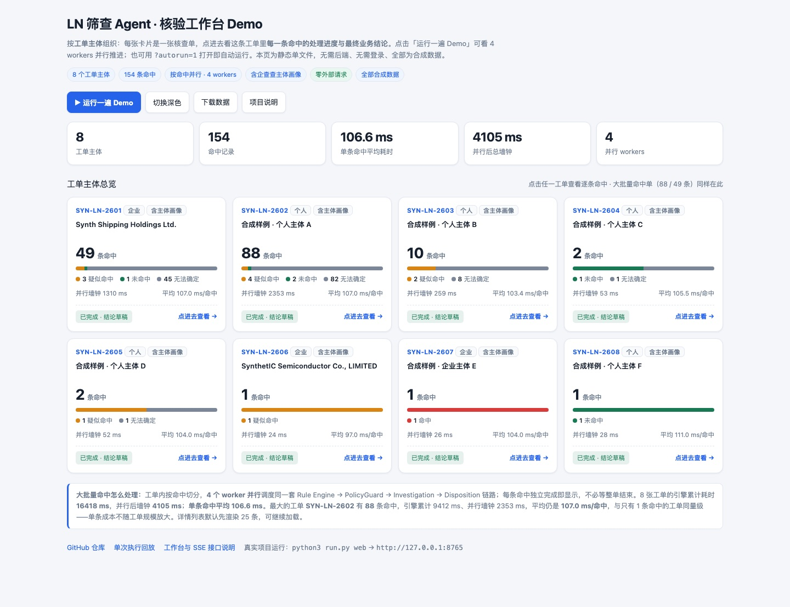
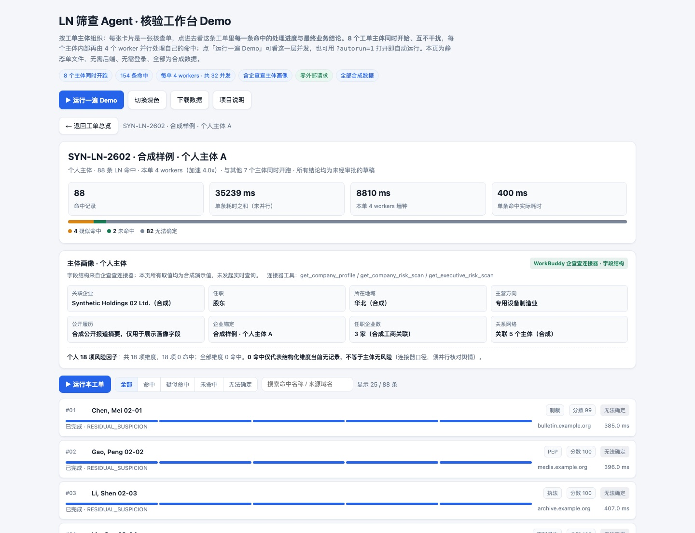
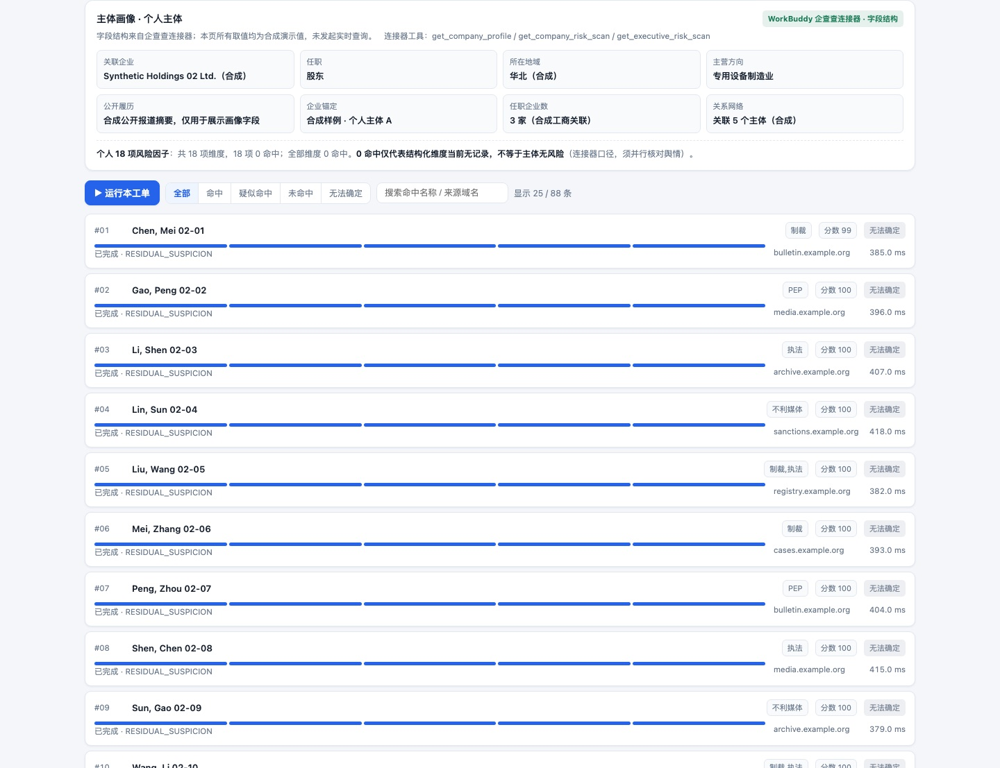
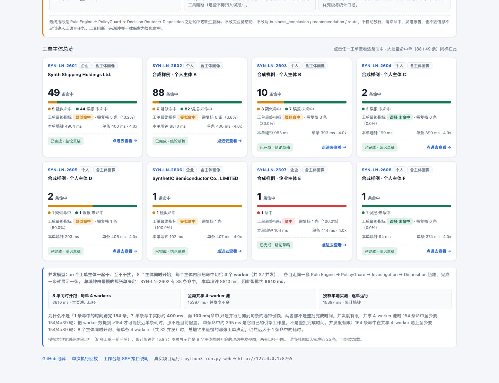
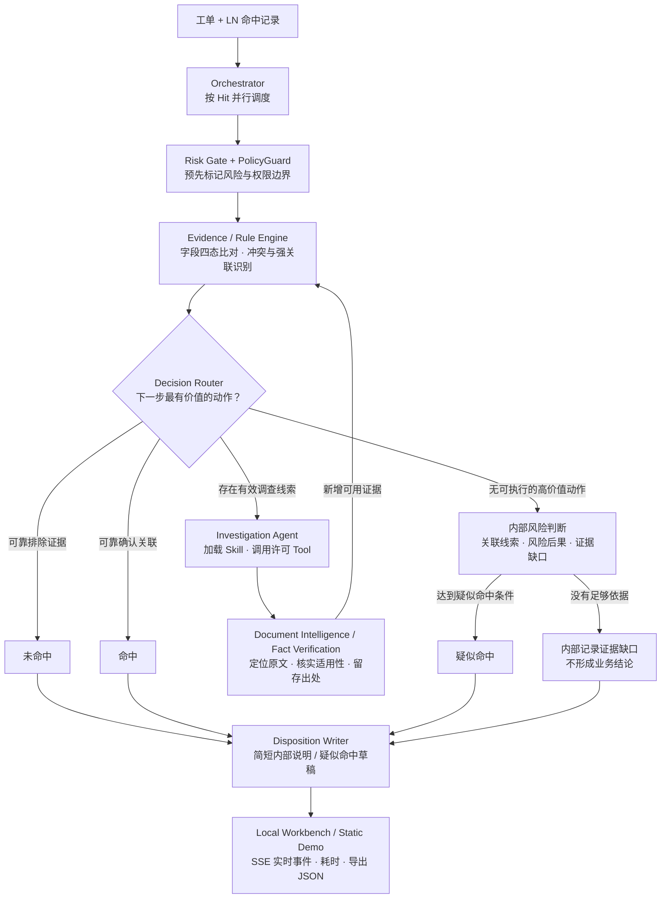

# LN Intelligent Screening Agent

**Evidence-driven · Policy-constrained · Observable**

面向商户入网（KYB）的 **LN 名单筛查 Agent 系统原型**。它将确定性身份判断、按需调查、文档证据处理和风险处置建议整合为一个可本地运行的工作流：**每条命中独立选择调查路径，面向业务的结论统一为「未命中 / 疑似命中 / 命中」。**

> **当前版本：v0.9.7 · 本地离线 MVP** 　|　 Python 3.10+ · 无必需第三方依赖 · 合成案例 · 默认不调用外部模型 · **259 项离线回归测试通过**

**v0.9.7 新增「说人话」说明层**：评审反馈「结果不像人话、看不懂到底怎么命中、其他怎么排除」。现在每条命中的**首屏**是一句话结论 + 逐字段比对表 + **为什么这么判** + **为什么不是别的结论** + **复核人下一步**；`DRAFT_NOT_APPROVED` / `FI-*` / 规则 ID / 来源域名 / 执行路径等技术字段全部折叠到「给开发 / 审计看」。首页还加了「**这一批是怎么判的 · 先看这里**」四句白话，解释命中 / 疑似命中 / 误报·未命中，以及为什么大批量都能归到误报。这是**展示层**：`ln_agent/plain_language.py` 只读取既有确定性字段，由 `PolicyGuard` 强制 `DISPLAY_ONLY`，不改业务结论、不加证据、不清命中。详见 [`docs/PLAIN_LANGUAGE.md`](docs/PLAIN_LANGUAGE.md)。

**v0.9.6「最终指标」**：每条命中除「业务结论草稿」外，还会得到一个明确的 **命中 / 疑似命中 / 误报·未命中** 派生指标，并汇总成全批唯一的 **需人工复核率**。规则是确定性的：证件号 / 注册号硬匹配 → 命中；同样缺身份信息但**名单事由重大且事发地一致** → 疑似命中；**没什么特别信息**（例如根本拿不到只有通知里才有的身份信息、也不重大）→ 误报·未命中。指标是 `Rule Engine → PolicyGuard → Decision Router → Disposition` 之后的**下游统计口径**，不改写业务结论、不自动放行、不因信息不足创建人工调查任务。详见 [`docs/FINAL_INDICATOR.md`](docs/FINAL_INDICATOR.md)。

## 一打开就能跑：多工单核验工作台 Demo

**在线地址：** <https://lkjhgfdsa-mnbvcxz.github.io/ln-screening-agent/demo.html>

| 想看什么 | 直接打开 |
|---|---|
| 打开即自动运行一遍 | <https://lkjhgfdsa-mnbvcxz.github.io/ln-screening-agent/demo.html?autorun=1> |
| 88 条命中的大单，点进去看逐条进度 | <https://lkjhgfdsa-mnbvcxz.github.io/ln-screening-agent/demo.html#SYN-LN-2602> |
| 单次执行的 68 事件回放 | <https://lkjhgfdsa-mnbvcxz.github.io/ln-screening-agent/replay.html> |

无需安装、无需登录、无需 API Key、无需后端；**一个静态 HTML 文件，零外部请求**。也可以直接下载仓库根目录的 [`demo.html`](demo.html) 用浏览器打开。内置数据见 [`examples/demo_workbench_data.json`](examples/demo_workbench_data.json)，用 `python3 scripts/build_demo.py` 可重新生成。

Demo 按评审最关心的层级组织：

1. **首页 = 先看懂判定逻辑 + 工单主体总览**：顶部「**这一批是怎么判的 · 先看这里**」用四句白话解释命中 / 疑似命中 / 误报·未命中，以及为什么大批量都能归到误报；下面是 8 张核查单卡片，显示命中条数、**最终指标分布**、并行墙钟、单条平均耗时，以及全批唯一的「**需人工复核率 11.0%**（17 / 154）」。
2. **点进任一工单 = 逐条命中**：每条命中显示 5 段进度与结论；**点开单行，首屏就是人话解释**——一句话结论、`字段 | 入网主体 | 名单记录 | 结果` 比对表、为什么这么判、为什么不是别的结论、复核人下一步、证据来源与草稿边界。技术字段（`DRAFT_NOT_APPROVED` / `FI-*` / 规则 ID / 来源域名 / 原始执行路径）折叠在底部。
3. **主体画像**：按 `company_ln` / `person_ln` Skill 契约生成企业与个人画像，字段结构取自 WorkBuddy 企查查连接器（`get_company_profile` / `get_company_risk_scan` / `get_executive_risk_scan`），并保留连接器口径「**0 命中仅代表结构化维度当前无记录，不等于主体无风险**」。
4. **运行一遍 Demo**：4 workers 并行推进，卡片进度条与命中阶段条同步变化。



> 画像字段的**取值全部是合成演示值**，页面已醒目注明「未发起实时查询」。企查查连接器本次实时调用返回 `402 credit_balance_insufficient`（积分余额不足），因此仓库不声称完成了真实画像查询；项目内 `tools/qcc/` 仍是 `not_connected` 占位。





### 一条命中到底怎么读（v0.9.7）

以合成命中单 `SYN-LN-2607` 为例，展开后首屏是这样一段人话，而不是状态码：

> **判定为命中**：企业名称对上了，更关键的是企业注册号完全一致，可以确认是同一个主体。
>
> | 比对项 | 入网主体 | 名单记录 | 结果 |
> |---|---|---|---|
> | 企业名称 | 合成样例·企业主体 E | Synthetic Azul Trading 07-01 Co., Ltd. | 名称匹配（只说明被名单捞出来，不能定性） |
> | 企业注册号 | SYN-USCC-0007 | SYN-USCC-0007 | **完全一致**（唯一标识，编号一致才算同一主体） |
> | 成立日期 / 所在地区 | 两侧相同 | 两侧相同 | 一致（交叉印证 / 辅助信息） |
>
> **为什么这么判**：唯一标识一字不差，且名称、日期、地区都没有冲突；名字相同只是把记录捞出来，真正定案的是唯一标识。
> **为什么不是别的结论**：没有硬身份字段冲突，所以不是未命中；也不需要再补证件信息，所以不是疑似命中。
> **复核人下一步做什么**：复核名单原文与主体证件，确认编号不是录入错误；这是草稿，需授权人员审批后才生效。

排除类命中同样写明「入网侧出生日期 1975-09-04 / 名单侧 1957-05-08 → 明确冲突 → 同名不同主体」，并强调**这不是放行**、命中记录未清除。地址 / 所在地区会变动，**不是硬排除依据**；说「没有任何冲突」之前必须先看比对表里有没有红色冲突行。机器字段统一折叠到「查看技术字段与执行路径（给开发 / 审计看）」。

**大批量命中怎么处理（m 个工单主体一起干、互不干扰）：** 8 个工单主体**同时开始**，每个主体内部把命中切给 **4 个 worker**（共 32 并发），各自走同一套 `Rule Engine → PolicyGuard → Investigation → Disposition` 链路，完成一条就显示一条。整批墙钟由**最慢的那张单**决定（88 条命中单约 8.8 s），既不是把 8 张单的耗时相加，也不是 1 条命中的耗时。

**为什么不是「106 ms 跑完 154 条」？** 这个数量级是**并行后摊到每条的墙钟份额**（15,922 ms ÷ 154 ≈ 103 ms），不是单条命中的实际工作量（约 395 ms），更不是整批完成时间。并发度有限：共享 4-worker 池时 154 条命中至少要 154/4 ≈ 39 轮（约 15.2 s）；8 个主体同时开跑、每单各 4 workers 时受最长单限制约 9.3 s；授权本地实测是逐单运行，累计 15.9 s。只有把 worker 数提到 ≥154 才可能接近单条耗时，那不是当前配置。Demo 把这三种口径并列展示，且用合成值复刻真实量级，不含任何真实业务数据。



> 公开仓库只包含合成案例与聚合计数。真实工单数据、完整事件日志和内部系统链接只保留在授权本地环境，未进入本仓库。

## 或者下载项目本地运行


本地 HTML 工作台展示**多命中并行进度、逐条结论、Skill / Rule / Policy / Tool 执行事件、各环节实际耗时**，并对照已有审核记录。完成一条显示一条，不必等待整单结束。**实时工作台保留不变**，仍由本地 Python 进程提供，不依赖公网后端。

```bash
git clone https://github.com/Lkjhgfdsa-mnbvcxz/ln-screening-agent.git
cd ln-screening-agent
python3 run.py web
# 浏览器打开 http://127.0.0.1:8765
```

无需 API Key，直接选择内置合成工单运行；下拉框中的 **「WorkBuddy 本地采集 · 合成回放」** 会演示两个授权本地适配器。服务仅监听 `127.0.0.1`，按 `Ctrl+C` 退出。

## 核心设计：不是每条命中都走完整流水线



**业务结论统一使用三种表述：未命中、疑似命中、命中。** 内部路由、评分与证据缺口只服务于判断和留痕，不出现在审核结论里；不足以支持结论时不虚构「未命中」。

### 七个值得关注的机制

| 机制 | 解决什么问题 |
|---|---|
| **Adaptive Routing** · 自适应分流 | 从现有字段开始，只有值得进一步调查才调用工具；新增证据后重新判断，无固定的逐级长流程。 |
| **Two Decision Engines** · 双引擎 | **身份判断**优先核对排除与关联证据；无法明确判断时，内部结合现有线索、风险性质和证据缺口确定能否建议「疑似命中」。评分不作为业务结论展示。 |
| **PolicyGuard + Risk Gate** · 权限边界 | Skill 不能自行授权结论；检查可用工具、证据等级和风险标志。名单风险不会因为低分或提前排除而被静默忽略。 |
| **Bounded Investigation** · 有限自主调查 | `Agent → Skill contract → Tool`；工具调用有白名单和预算。v0.9.3 新增两个授权本地只读适配器，见下文。 |
| **Document Intelligence + Provenance** · 文档证据链 | 在长文档中定位关键词、阅读上下文、扫描重要线索，记录原文位置、来源与文件版本；**自动提取不等于已核实**，独立来源佐证和冲突另行处理。 |
| **Model Facts Are Unchecked** · 模型事实围栏 | 会话内模型只能产出 `model_extracted / checked=false` 的候选事实，不能触发硬规则；`PolicyGuard` 按 Tool manifest 校验来源与核实状态，伪装来源直接抛 `PolicyViolation`。 |
| **Disposition Writer** · 业务闭环 | 业务展示目标只有**未命中 / 疑似命中 / 命中**及一两句核心依据；需要上报的记录另外生成**未发送**的合规草稿。调查无新增价值时不默认转人工队列。 |

## v0.9.3：把 WorkBuddy 能力接进既有链路，而不是重做审核流程

新增能力全部以 **Skill 契约 + Tool manifest** 的形式挂到现有 `Decision Router → Investigation Agent` 上，`Rule Engine → PolicyGuard → RiskGate → Disposition` 的顺序与判定逻辑保持不变。

| 前缀 | Tool | Skill | 授权方式 | 产出 |
|---|---|---|---|---|
| `boss:` | `workbuddy_browser_readonly` | `workbuddy_capture` | 仅本地、只读、默认 Policy **不授权**；需显式 `authorized_policy()` | 已登录浏览器页面的结构化字段，只允许 `ln_structured` / `official_primary` |
| `model:` | `workbuddy_llm_capture` | `workbuddy_capture` | 同上；staged transport，零外部 API 调用 | 会话内模型抽取候选，恒为 `model_extracted / checked=false` |

完整链路与「模型为什么不能自行编造审核依据」的五道防护见 [`docs/WORKBUDDY_INTEGRATION.md`](docs/WORKBUDDY_INTEGRATION.md)。真实运行环境里，浏览器采集只 attach 用户已登录的标签、不新建/导航/刷新/写回；采集包只保存在授权本地目录。

## 一个工单，不同命中走不同路径

| 合成情形 | 业务结论草稿 | 最终指标 | 简洁依据 |
|---|---|---|---|
| 两方可靠出生日期存在明确且不可解释的冲突，并满足授权的排除规则 | **未命中** | 误报·未命中 | 出生日期不一致，有可靠排除依据。 |
| 个人姓名、完整出生日期及有效身份证件号码可靠一致，达到确认规则 | **命中** | 命中（FI-1） | 核心身份信息一致；另按名单风险性质处置。 |
| 企业名称高度一致、地址存在差异，涉及重大名单风险且无法排除关联 | **疑似命中** | 疑似命中（FI-2） | 名称一致；地址差异不足以排除，涉及重要名单事由。 |
| 只有姓名一致、拿不到独立身份字段，但名单事由重大且事发地与主体地区一致 | **无法确定**（业务结论留空） | 疑似命中（FI-2） | 同样的信息缺口，但「很严重 + 事发地一致」，保留复核，不归入误报。 |
| 只有姓名一致，浏览器与模型都未带来可区分身份的独立字段，也无重大事由 | **无法确定**（业务结论留空，内部 `RESIDUAL_SUSPICION`） | 误报·未命中（FI-3） | 逐条写明本条的记录源、LN 记录号与缺失的独立身份字段；按误报**归集**用于统计与复核优先级，**不写「未命中」结论、不放行、不自动建人工队列**。 |
| 工具 / 政策阻断，或来源存在冲突 | **无法确定** | 疑似命中（FI-2） | 不得归入误报，保留复核。 |

> **两个轴不要混为一谈：** 业务结论草稿仍严格保持「未命中 / 疑似命中 / 命中 / 留空」，缺乏足够依据时绝不自动写成「未命中」；最终指标是在其之后**派生**的复核优先级与统计口径，`final_indicator_does_not_clear_hit` 恒为 `True`，`PolicyGuard.validate_disposition_draft()` 会拒绝任何篡改。所有结论均为候选草稿，不会自动审批或写回。

## Agent、Skills 与 Tools 怎样协作？

项目由 **1 个主调度器 + 确定性决策内核 + 受限调查能力 + 8 个专项 Skills + 12 个 Tool 描述**组成。Skill 是核验方法与执行契约，Tool 是实际执行动作；它们不是彼此独立运行的 AI 聊天机器人。

| 层级 | 主要职责 | 入口 |
|---|---|---|
| **Orchestrator / Router** | 按命中并行、选择动作、收集结构化结果 | [`ln_agent/`](ln_agent/) |
| **Rules / PolicyGuard / Gate** | 四态字段比对、规则权限、风险标志、证据冲突 | [`ln_agent/rules/`](ln_agent/rules/) · [`ln_agent/policy_guard.py`](ln_agent/policy_guard.py) |
| **Skills（8）** | 人员、企业、地址、文档智能、来源恢复、内部风险判断、处置文案、WorkBuddy 本地采集 | [`skills/`](skills/README.md) |
| **Tools（12 个描述）** | 离线研究、文档解析、事实核验、来源佐证、文案生成、两个授权本地采集适配器，以及待接通的外部连接器 | [`tools/`](tools/README.md) |
| **Evidence & Review** | 证据来源、独立佐证、人工核实记录与 REOPEN 历史 | [`ln_agent/fact_verification.py`](ln_agent/fact_verification.py) · [`ln_agent/review_store.py`](ln_agent/review_store.py) |
| **Workbench / Demo** | 本地 HTML、SSE、逐命中时间线、耗时、静态多工单 Demo | [`ln_agent/workbench/`](ln_agent/workbench/) · [`demo.html`](demo.html) · [`replay.html`](replay.html) |

**每个 Skill** 都包含 `README.md`、`SKILL.md` 和 `contract.json`（运行时约束）。**每个 Tool** 都有自己的 `README.md` 与 `tool.json`，并标注真实连接状态。运行 `python3 run.py inspect` 可查看已注册能力。

工作台展示的是**真实代码调用点**产生的 `SKILL_SELECTED`、`RULE_EVALUATED`、`POLICY_CHECK`、`TOOL_STARTED` / `TOOL_FINISHED` 等事件，经 SSE 实时送达浏览器；不额外调用 LLM 生成「执行过程解说」。已有人工审核结论只作为**独立历史流程记录**对照展示，不会覆盖 Agent 建议，也不充当已验证的身份事实。

## 运行、测试与可选模型接口

```bash
python3 run.py web                          # 启动本地实时工作台（127.0.0.1）
python3 run.py demo                         # 强关联 + 误报候选的两个合成案例
python3 -m scripts.run_disposition_demo     # 疑似命中与简洁说明示例
python3 run.py inspect                      # 查看 Skills / Tools 实际状态
python3 run.py llm-status                   # 检查模型配置，不联网
python3 scripts/build_demo.py               # 重新生成多工单静态 Demo
python3 scripts/build_replay.py --tests 259 # 重新生成单案例执行回放
python3 scripts/check_sensitive.py          # 推送前全仓敏感数据发布闸门
python3 -m unittest discover -s tests -v    # 259 项离线回归测试
```

可选的大模型接口已预留在 [`ln_agent/llm_adapter.py`](ln_agent/llm_adapter.py)，配置模板见 [`.env.example`](.env.example)。留空即运行合成离线模式。**外部 OpenAI-compatible 自动调查主流程仍未接通**；即使将来接入，模型提取的事实仍需经过证据核实与 PolicyGuard，不能自行决定硬排除或写回名单系统。

## 实测规模（授权本地环境，只公开聚合计数）

在获授权的内部环境中，用只读浏览器采集 + 会话内模型抽取逐条跑过 **8 张真实 LN 工单 / 154 条命中**，结果保存在授权本地目录，不进入本仓库：

| 指标 | 结果 |
|---|---|
| 事件总数 | 3,360 个 |
| **单条命中实际引擎耗时** | **394.863 ms**（中位数 389.985 ms；154 条工作量合计 60,808.866 ms） |
| 单内并行加速 | 4 workers；49 / 88 条命中的大单实测加速比 **3.93x / 3.97x** |
| 逐单串行累计墙钟 | **15,922.158 ms**（8 张工单在授权本地是**依次**运行的；外层计时 15,942.572 ms） |
| 并行后摊到每条的墙钟份额 | 103.391 ms / 命中（15,922.158 ÷ 154）——**不是单条实际耗时，也不是整批完成时间** |
| 若 8 个主体同时开跑 | 约 **9,290 ms**（每单各 4 workers、共 32 并发，总墙钟 = 最慢的单）；若只共享 1 个 4-worker 池则约 15,202 ms |
| Tool 调用 | 浏览器只读 154 次、会话内模型 16 次；采集包唯一读取 154 次，无重复查询 |
| 业务结论 / 路由 | 业务结论：1 条 `疑似命中`（附 1 份未发送上报草稿）、153 条留空；路由：`RESIDUAL_SUSPICION` 153 条、`EVIDENCE_CONFLICT_REVIEW` 1 条 |
| 逐条说明 | **154 / 154 条各不相同**，均写明本条记录源、LN 记录号与缺失的独立身份字段 |
| 安全计数 | 人工队列 0 · 自动发送 0 · 自动放行 0 |
| 回归测试 | **259 项全部通过**（含 14 项公开 Demo 安全 / 人话说明测试、15 项 `plain_summary` 展示层与围栏测试、14 项最终指标规则测试、9 项公开回放安全测试、8 项发布闸门测试） |

对照人审结论发现并修复了两类真实缺陷：

1. **取数缺陷**：授权本地转换器最初只把姓名交给引擎，丢弃了核查单里的 `分数 / 记录源 / ID号码 / LN报警ID / 地址 / 申请人统一信用代码`。修复后重建 `risk_event`，1 张真实命中单由「无结论」恢复为「疑似命中」（名称一致、LN 分数 100、20 条记录源可追溯，但命中侧只有 LN 内部记录号，无法做证件级比对）；另一张因统一信用代码冲突进入 `EVIDENCE_CONFLICT_REVIEW`。
2. **文案缺陷**：证据不足分支原先吞掉逐条上下文，输出 7 种模板。修复后每条都带自己的记录源与缺字段说明，并新增 `tests/test_per_hit_reason.py` 锁定「不得写成误报 / 不得据此放行」。
3. **并发口径缺陷**：`Orchestrator.stats.elapsed_ms` 是**整单经 4 workers 并行后的墙钟**，不是各命中耗时之和；授权脚本又把 `HIT_FINISHED.duration_ms` 误从 `details` 里取，导致 154 个 null。此前把 103.391 ms 当成单条耗时再除以 4，等于把 4 倍加速算了两次，并把逐单串行的累计墙钟标成「并行后总墙钟」。现已从事件日志重算单条真实耗时、加速比与三种墙钟口径，Demo 动画也改为 8 个主体同时开始、按各自墙钟比例完成（4 条命中为一组推进）。

另外明确锁定了两个**设计性分歧**：跨省/地址不同不得自动排除，信息不足不得自动创建人工调查任务；中文 provider 类别别名 `制裁 / 执法 / PEP / 不利媒体` 已标准化，保证 `SCREENING_REVIEW_REQUIRED` 不被静默丢弃。

> 为什么多数命中的**业务结论**仍是「无法确定」？已接通的证据范围内，命中侧普遍只回传 LN 内部记录号，没有可与入网主体做证件级比对的独立字段，引擎按设计停在 `RESIDUAL_SUSPICION` 并逐条记录证据缺口。这既不等于「误报」，也不等于「放行」，更不等于可以据此免审。
>
> v0.9.6 起，这些命中在**最终指标**这个独立轴上不再停在「无结论」：无重大事由 / 事发地不一致的按 FI-3 归入「误报·未命中」用于统计与复核优先级；重大且事发地一致的按 FI-2 保留「疑似命中」。业务结论草稿一字未改。合成 Demo 中 154 条命中→ 命中 1 / 疑似命中 16 / 误报·未命中 137，**需人工复核率 11.0%**。

## 严格基于项目机制，以及修掉的项目自身缺陷

**回答评审常问的一句：这次是按项目既有机制跑的，还是项目本身有问题、我顺手改了？——两者都有。** 审核流程没有重新设计，但真实运行确实暴露了项目自身若干缺陷，逐项修复并补了回归测试。完整清单见 [`docs/FINAL_INDICATOR.md`](docs/FINAL_INDICATOR.md) 的「机制边界与优化清单」。

**完全沿用、没有重做的部分**

- `Rule Engine → PolicyGuard → RiskGate → Decision Router → Disposition` 的顺序与判定逻辑；`Investigation Agent` 只按 Router 授权结果调用适配器。
- `Fact` 四态字段、`eligible_for_hard()` 来源白名单、脱敏值不参与硬相等 / 冲突；硬排除规则必须经公司批准。
- Skill `contract.json` 与 Tool `tool.json` 的权限登记、`check_tool_call()`、`validate_facts()`、`validate_disposition_draft()` 三道围栏；模型事实恒为 `model_extracted / checked=false`。
- 业务结论只有「未命中 / 疑似命中 / 命中」，且一律 `DRAFT_NOT_APPROVED`；不自动发送、放行、关闭工单或写回。
- 本地 SSE 实时工作台、Reviewer ledger、事件留痕与既有 219 项测试的行为契约。

**项目自身确实存在的缺陷（已修复，附回归测试）**

| # | 缺陷 | 后果 | 修复 |
|---|---|---|---|
| 1 | 授权本地转换器只把姓名喂给引擎，丢弃 `分数 / 记录源 / ID号码 / LN报警ID / 地址 / 申请人 USCC` | 154 条命中几乎全部「无结论」，真实命中单被判成留空 | 重建项目既有 `Hit.risk_event` 通道，补 `registration_number` 等结构化事实；真实命中单恢复为「疑似命中」 |
| 2 | `disposition.py` 证据不足分支吞掉逐条上下文 | 150+ 条说明塌缩成同一句模板 | 补记录源、主域名、LN 记录号与缺字段说明；`tests/test_per_hit_reason.py` 锁定 154/154 各不相同 |
| 3 | `run_authorized.py` 从 `details` 取 `HIT_FINISHED.duration_ms`，实际在事件顶层 | 154 个耗时全是 null，性能统计无从谈起 | 改取顶层字段并从事件日志重算 |
| 4 | 把 `Orchestrator.stats.elapsed_ms`（整单 4-worker 并行后墙钟）当作单条耗时，再除以 4 | 4 倍加速被算了两次；逐单串行累计墙钟被标成「并行总墙钟」 | 区分单条工作量 / 单内墙钟 / 逐单累计 / 全批同时开跑三种口径，Demo 动画改为 8 主体同时开始 |
| 5 | `ReviewStore.backup()` 用 `with sqlite3.connect()` 只管事务不关连接 | sqlite 句柄泄漏 + `ResourceWarning` | 改用 `closing()`，并加断言两个连接都关闭 |
| 6 | `build_replay.py` 会覆盖 `index.html` | 多工单 Demo 入口被单案例回放抢走 | 入口归属 `build_demo.py`，并加回归测试 |
| 7 | 中文 provider 类别别名缺失 | `SCREENING_REVIEW_REQUIRED` 被静默丢弃 | 补 `制裁 / 执法 / 政治公众人物 / 不利媒体` 别名 |
| 8 | 初始提交的测试文件里写了真实工单号与真实企业名 | 公开仓库历史里残留真实业务标识 | 重写 git 历史清除该文件，并加 `scripts/check_sensitive.py` 全仓 + 全历史发布闸门 |

**在既有链路上新增、而非另起炉灶的能力**：`workbuddy_browser_readonly` / `workbuddy_llm_capture` 两个 Tool 与 `workbuddy_capture` Skill（通过 `tool_for_source_key()` 查表挂到 Router）、`Decision.research_facts` 来源证据、公开合成回放、按工单主体的静态 Demo、下游派生的最终指标、发布闸门。

> 公开仓库**只含合成数据与聚合计数**。真实工单、DOM 抓取、完整事件日志、内部域名与凭证只留在授权本地目录；`python3 scripts/check_sensitive.py` 会在推送前按形态扫描全部跟踪文件与全部历史提交，也可用 `--vocab <仓库外路径>` 加跑词表检查。

## 已接通 / 未接通功能清单

| 已接通（本地 / 授权本地） | 未接通（需外部系统或生产授权） |
|---|---|
| 确定性规则、Evidence、RiskGate、PolicyGuard、DecisionRouter | 真实 LN / BOSS 在线只读 API |
| 单内 4-worker 多命中并行、8 主体同时开跑的静态 Demo、SSE 实时工作台、单案例事件回放 | QCC / 企查查**实时数据**（项目内仍为 `not_connected`；连接器本次积分不足） |
| 8 个 Skill 契约、12 个 Tool manifest 与权限登记 | 官方登记处在线接口、官方 / 监管名单在线鉴真 |
| 本地 `fixture_research`、`document_intelligence`、`fact_verification`、`source_corroboration`、`disposition_writer` | 公网 Python 后端、生产级身份认证与授权 |
| WorkBuddy 授权本地只读浏览器采集（`boss:` 前缀） | 自动审批 / 自动放行 / 自动发送 / 向 LN·BOSS 写回 |
| WorkBuddy 会话内模型 staged 抽取（`model:` 前缀，零外部 API 调用） | 外部 OpenAI-compatible 自动调查主流程（仍为 optional） |
| 中文 provider 类别标准化、`Decision.research_facts` 来源证据导出 | 任意用户文档上传、长期任务完整断点恢复 |
| 企查查连接器**字段结构**的主体画像（合成值，明确标注未实时查询） | 企查查真实画像落库与自动交叉验证 |
| **最终指标 FI-1/2/3**、工单级汇总与需人工复核率（派生统计口径） | 把最终指标当作已批准的业务处置结论（明确未做） |
| **全仓 + 全历史敏感数据发布闸门** `scripts/check_sensitive.py` | 真实业务数据的公网托管与在线查询 |
| 合成案例、离线回放、逐条业务说明、未发送的上报草稿 | LLM 自主搜索规划与自主终止调查 |

> [!IMPORTANT]
> **这是开发与演示用 Agent Harness，并非已获批准的生产审核系统。** 公开仓库中的运行数据均为合成数据；名单风险权重、上报阈值和排除权限属于候选配置。真实业务数据、内部系统链接、凭证及未获授权的文件不得上传公开 GitHub 或发送至外部模型。

## 深入阅读

[多工单 Demo](demo.html) · [执行回放](replay.html) · [最终指标与机制边界](docs/FINAL_INDICATOR.md) · [本地工作台与事件接口](docs/WORKBENCH.md) · [WorkBuddy 本地能力接入](docs/WORKBUDDY_INTEGRATION.md) · [处置说明生成](docs/DISPOSITION_OUTPUTS.md) · [Skill 目录](skills/README.md) · [Tool 目录](tools/README.md) · [合成案例说明](examples/README.md) · [WorkBuddy 开发交接](docs/WORKBUDDY_HANDOFF.md) · [Agent 开发约束](AGENTS.md)

---

<sub>Built for evidence-first screening: fast when facts suffice, explicit when uncertainty remains.</sub>
