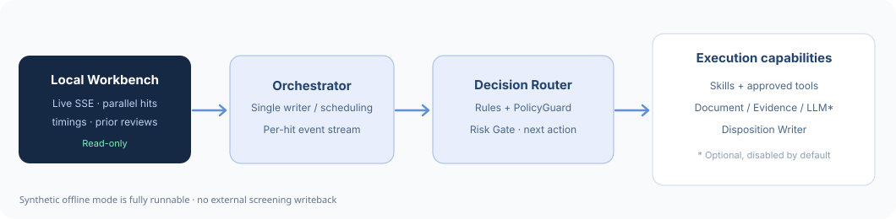

# LN Intelligent Screening Agent

**本地可运行 · 动态核验 · 多 Skill / Tool · 实时工作台**

以证据为依据的 LN 名单核验 **开发原型**：多条命中并行判断、按需调查、生成简洁的内部说明及疑似命中草稿。无 API Key 也可运行合成案例。



## 启动

```bash
python3 run.py web
# 打开 http://127.0.0.1:8765
```


*图为合成数据页面预览；实际耗时与状态由本地运行产生。*

```bash
python3 run.py demo                          # 强关联 + 误报候选
python3 run.py inspect                       # 查看 Skill / Tool 状态
python3 run.py llm-status                    # 模型接口配置（不会请求外网）
python3 -m unittest discover -s tests -q     # 完整回归
```

## 代码导航

| 位置 | 内容 |
|---|---|
| [`ln_agent/`](ln_agent/) | Router、Rule Engine、PolicyGuard、Risk Gate、证据与处置生成 |
| [`skills/`](skills/) | 7 个 Skill；每个都有 README、SKILL.md 和执行契约 |
| [`tools/`](tools/) | 10 个 Tool 定义；当前本地工具可用，真实外部连接器待授权接入 |
| [`ln_agent/workbench/`](ln_agent/workbench/) | 本地 HTML + SSE 实时进度、并行运行、计时和历史结论对照 |
| [`examples/`](examples/) / [`tests/`](tests/) | 合成案例、回归测试 |
| [`scripts/`](scripts/) | 保留必要的文档 / 处置演示入口 |

详见 [工作台](docs/WORKBENCH.md)、[处置文案](docs/DISPOSITION_OUTPUTS.md)、[WorkBuddy 交接](docs/WORKBUDDY_HANDOFF.md) 和 [Agent 开发约束](AGENTS.md)。

## 模型接口与部署边界

`.env.example` 中预留 OpenAI-compatible API；**留空可运行**，默认不会把商户数据发往模型。实际调查模型还未接入动态执行路径，LN / BOSS / 企查查 / 公开网页的真实只读接口也尚未接通。所有处置仅为草稿，**不会发送消息、自动放行或写回 LN**。

> **Git 安全提醒**：仅在获授权范围内共享源码；仓库只使用合成数据。不要提交真实商户数据、内部 BOSS 链接、SOP、API Key、Cookie、运行数据库或本地报告。建议先用 Private 仓库。
