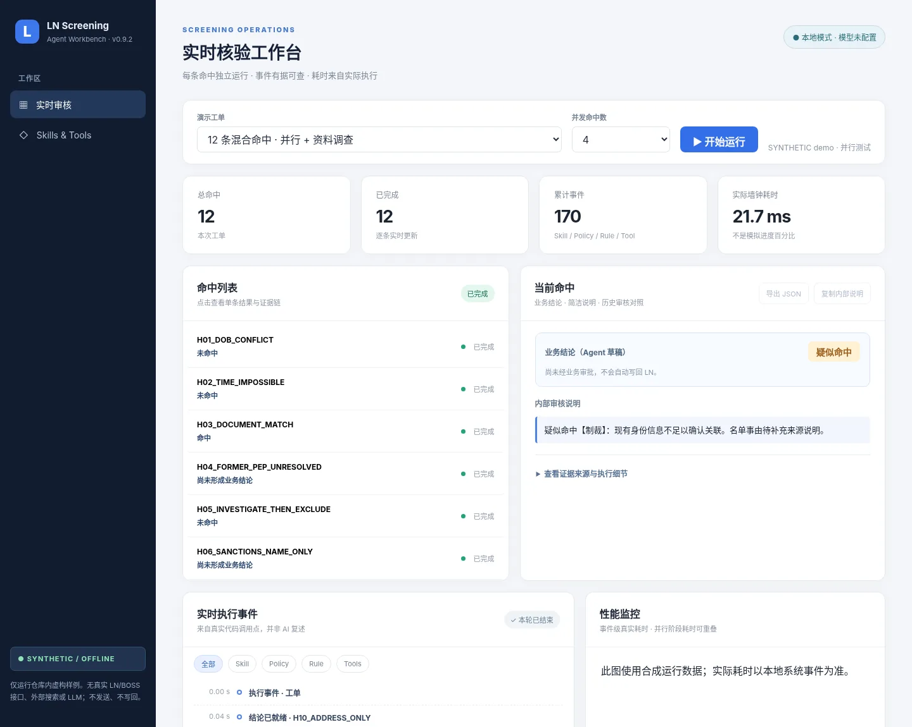
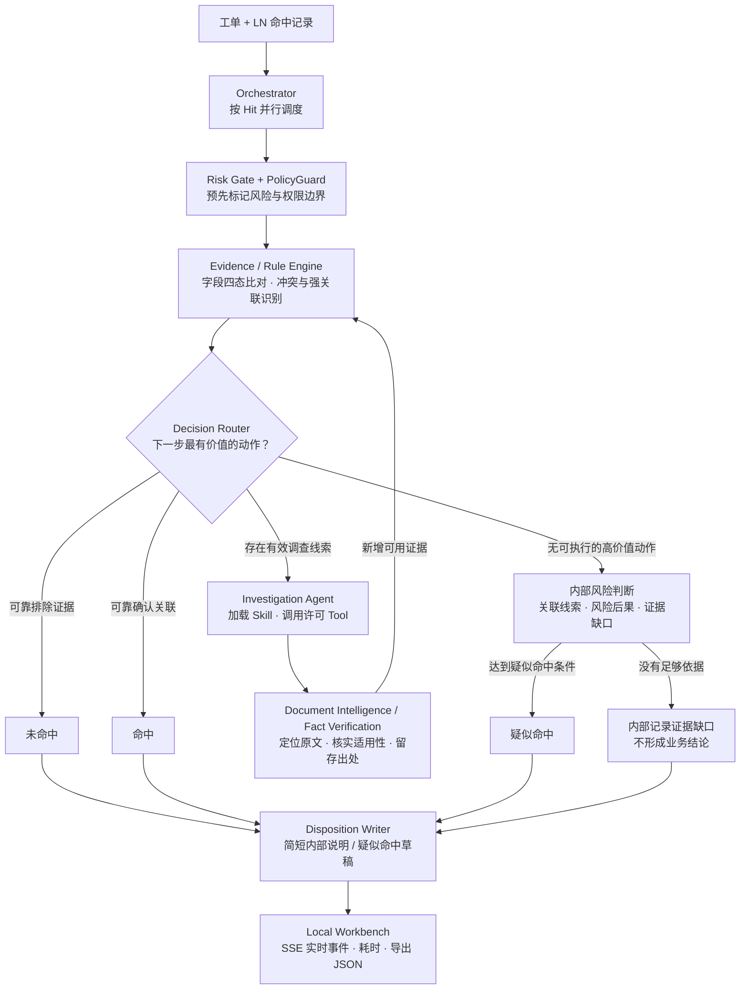

# LN Intelligent Screening Agent

**Evidence-driven · Policy-constrained · Observable**

面向商户入网（KYB）的 **LN 名单筛查 Agent 系统原型**。它将确定性身份判断、按需调查、文档证据处理和风险处置建议整合为一个可本地运行的工作流：**每条命中独立选择调查路径，面向业务的结论统一为「未命中 / 疑似命中 / 命中」。**

> **当前版本：v0.9.2 · 本地离线 MVP** 　|　 Python 3.10+ · 无必需第三方依赖 · 合成案例 · 默认不调用外部模型

## 先看看它如何运行



本地 HTML 工作台展示**多命中并行进度、逐条结论、Skill / Rule / Policy / Tool 执行事件、各环节实际耗时**，并对照已有审核记录。完成一条显示一条，不必等待整单结束。

```bash
python3 run.py web
# 浏览器打开 http://127.0.0.1:8765
```

无需 API Key，直接选择内置合成工单运行。服务仅监听 `127.0.0.1`，按 `Ctrl+C` 退出。

## 核心设计：不是每条命中都走完整流水线



**业务结论统一使用三种表述：未命中、疑似命中、命中。** 内部路由、评分与证据缺口只服务于判断和留痕，不出现在审核结论里；不足以支持结论时不虚构「未命中」。

### 六个值得关注的机制

| 机制 | 解决什么问题 |
|---|---|
| **Adaptive Routing** · 自适应分流 | 从现有字段开始，只有值得进一步调查才调用工具；新增证据后重新判断，无固定的逐级长流程。 |
| **Two Decision Engines** · 双引擎 | **身份判断**优先核对排除与关联证据；无法明确判断时，内部结合现有线索、风险性质和证据缺口确定能否建议「疑似命中」。评分不作为业务结论展示。 |
| **PolicyGuard + Risk Gate** · 权限边界 | Skill 不能自行授权结论；检查可用工具、证据等级和风险标志。名单风险不会因为低分或提前排除而被静默忽略。 |
| **Bounded Investigation** · 有限自主调查 | `Agent → Skill contract → Tool`；工具调用有白名单和预算。当前离线版使用模拟调查工具，外部 LLM 自主调查尚待接入。 |
| **Document Intelligence + Provenance** · 文档证据链 | 在长文档中定位关键词、阅读上下文、扫描重要线索，记录原文位置、来源与文件版本；**自动提取不等于已核实**，独立来源佐证和冲突另行处理。 |
| **Disposition Writer** · 业务闭环 | 业务展示目标只有**未命中 / 疑似命中 / 命中**及一两句核心依据；需要上报的记录另外生成**未发送**的合规草稿。调查无新增价值时不默认转人工队列。 |

## 一个工单，不同命中走不同路径

| 合成情形 | 业务结论 | 简洁依据 |
|---|---|---|
| 两方可靠出生日期存在明确且不可解释的冲突，并满足授权的排除规则 | **未命中** | 出生日期不一致，有可靠排除依据。 |
| 个人姓名、完整出生日期及有效身份证件号码可靠一致，达到确认规则 | **命中** | 核心身份信息一致；另按名单风险性质处置。 |
| 企业名称高度一致、地址存在差异，涉及重大名单风险且无法排除关联 | **疑似命中** | 名称一致；地址差异不足以排除，涉及重要名单事由。 |

> **当前实现边界：** 工作台与 JSON 已分别输出业务结论、技术路径和审批状态；缺乏足够依据时，业务结论留空，绝不自动写成「未命中」。所有结论均为候选草稿，不会自动审批或写回。

业务说明尽量保持 **结论 + 最关键的一致项/冲突项 + 主要事由**，不堆叠评分、引擎名称和搜索过程。完整证据、触发规则和调查路径仍保存在 JSON 与审计记录中。

## Agent、Skills 与 Tools 怎样协作？

项目由 **1 个主调度器 + 确定性决策内核 + 受限调查能力 + 7 个专项 Skills + 10 个工具描述**组成。Skill 是核验方法与执行契约，Tool 是实际执行动作；它们不是彼此独立运行的 AI 聊天机器人。

| 层级 | 主要职责 | 入口 |
|---|---|---|
| **Orchestrator / Router** | 按命中并行、选择动作、收集结构化结果 | [`ln_agent/`](ln_agent/) |
| **Rules / PolicyGuard / Gate** | 四态字段比对、规则权限、风险标志、证据冲突 | [`ln_agent/rules/`](ln_agent/rules/) · [`ln_agent/policy_guard.py`](ln_agent/policy_guard.py) |
| **Skills（7）** | 人员、企业、地址、文档智能、来源恢复、内部风险判断、处置文案 | [`skills/`](skills/README.md) |
| **Tools（10 个描述）** | 离线研究、文档解析、事实核验、来源佐证、文案生成，以及待接入的外部连接器 | [`tools/`](tools/README.md) |
| **Evidence & Review** | 证据来源、独立佐证、人工核实记录与 REOPEN 历史 | [`ln_agent/fact_verification.py`](ln_agent/fact_verification.py) · [`ln_agent/review_store.py`](ln_agent/review_store.py) |
| **Workbench** | 本地 HTML、SSE、逐命中时间线、耗时和历史结论对照 | [`ln_agent/workbench/`](ln_agent/workbench/) |

**每个 Skill** 都包含 `README.md`（给人看的使用说明）、`SKILL.md`（核验方法）和 `contract.json`（运行时约束）。**每个 Tool** 都有自己的 `README.md` 与 `tool.json`，并标注真实连接状态。运行 `python3 run.py inspect` 可查看已注册能力。

### 审核结果不是靠 AI 逐个传话

每条命中的状态由 Python 结构化对象传递。工作台展示的是**真实代码调用点**产生的 `SKILL_SELECTED`、`RULE_EVALUATED`、`POLICY_CHECK`、`TOOL_STARTED` / `TOOL_FINISHED` 等事件，经 SSE 实时送达浏览器；不额外调用 LLM 生成“执行过程解说”。

已有人工审核结论作为**独立的历史流程记录**对照展示，不会悄悄覆盖 Agent 的新建议，也不会直接充当已经验证的身份事实。

## 运行、测试与可选模型接口

```bash
python3 run.py web                          # 启动本地工作台
python3 run.py demo                         # 强关联 + 误报候选的两个合成案例
python3 -m scripts.run_disposition_demo     # 疑似命中与简洁说明示例
python3 run.py inspect                      # 查看 Skills / Tools 实际状态
python3 run.py llm-status                   # 检查模型配置，不联网
python3 -m unittest discover -s tests -v    # 离线回归测试
```

可选的大模型接口已预留在 [`ln_agent/llm_adapter.py`](ln_agent/llm_adapter.py)，配置模板见 [`.env.example`](.env.example)：

```dotenv
LN_LLM_ENABLED=false
LN_LLM_BASE_URL=
LN_LLM_API_KEY=
LN_LLM_MODEL=
LN_LLM_ALLOW_EXTERNAL=false
```

留空即运行合成离线模式。**目前模型适配器尚未接入自动调查主流程**；未来即使接入，模型提取的事实仍需经过证据核实与 PolicyGuard，不能自行决定硬排除或写回名单系统。

## 当前能力边界

| 已在本地原型实现 | 尚未接通 / 不属于当前版本 |
|---|---|
| 动态路由、确定性规则与 PolicyGuard；多命中并行和 SSE 工作台 | 真实 LN / BOSS / 企查查 / 官方登记处在线只读接口 |
| 本地文档定位、上下文提取、来源记录、部分核实与 SQLite 审阅历史 | 自动化官方来源鉴真、任意真实商户工单接入 |
| 合成案例、离线测试、简洁内部说明和上报草稿 | LLM 自主搜索规划、生产级权限体系、长期任务完整断点恢复 |
| 只读历史审核对照、真实调用点事件和本地耗时记录 | 自动审批、自动发送合规消息或向 LN/BOSS 写回 |

> [!IMPORTANT]
> **这是开发与演示用 Agent Harness，并非已获批准的生产审核系统。** 当前运行数据均为合成数据；名单风险权重、上报阈值和排除权限属于候选配置。真实业务数据、内部系统链接、凭证及未获授权的文件不得上传公开 GitHub 或发送至外部模型。

## 深入阅读

[本地工作台与事件接口](docs/WORKBENCH.md) · [处置说明生成](docs/DISPOSITION_OUTPUTS.md) · [Skill 目录](skills/README.md) · [Tool 目录](tools/README.md) · [WorkBuddy 开发交接](docs/WORKBUDDY_HANDOFF.md) · [Agent 开发约束](AGENTS.md)

---

<sub>Built for evidence-first screening: fast when facts suffice, explicit when uncertainty remains.</sub>
